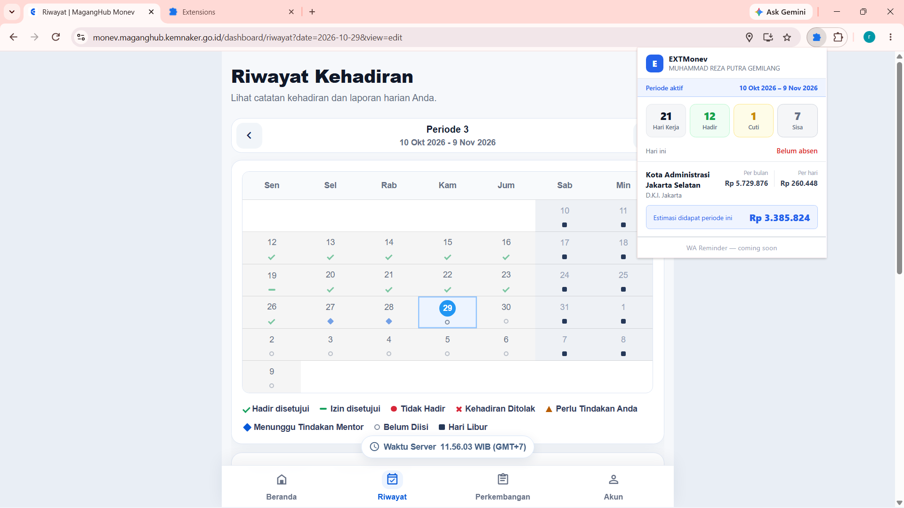

# EXTMonev

Chrome Extension untuk melihat informasi uang saku dan rekap kehadiran periode magang Kemnaker secara cepat, langsung dari browser.

## Fitur

- Informasi uang saku bulanan & estimasi per hari berdasarkan UMK kota magang
- Rekap kehadiran periode aktif: hari kerja, hadir, cuti, sisa, dan status hari ini
- Estimasi uang saku yang sudah didapat periode ini
- Tidak perlu login terpisah — membaca session dari tab Kemnaker Monev yang sudah terbuka

## Cara Install

Extension ini belum tersedia di Chrome Web Store. Install manual dengan langkah berikut:

1. Download atau clone repository ini
2. Buka Chrome, masuk ke `chrome://extensions`
3. Aktifkan **Developer mode** di pojok kanan atas
4. Klik **Load unpacked**
5. Pilih folder `extension/` dari repository ini

## Cara Pakai

1. Buka dan login di [monev.maganghub.kemnaker.go.id](https://monev.maganghub.kemnaker.go.id)
2. Klik ikon EXTMonev di toolbar browser
3. Data gaji dan kehadiran akan muncul otomatis

## Catatan

- Extension hanya membaca data dari session yang sudah aktif di tab Kemnaker Monev
- Tidak menyimpan password atau data sensitif apapun
- Data UMK bersumber dari data resmi Kemnaker (3.086 kota/kabupaten)
